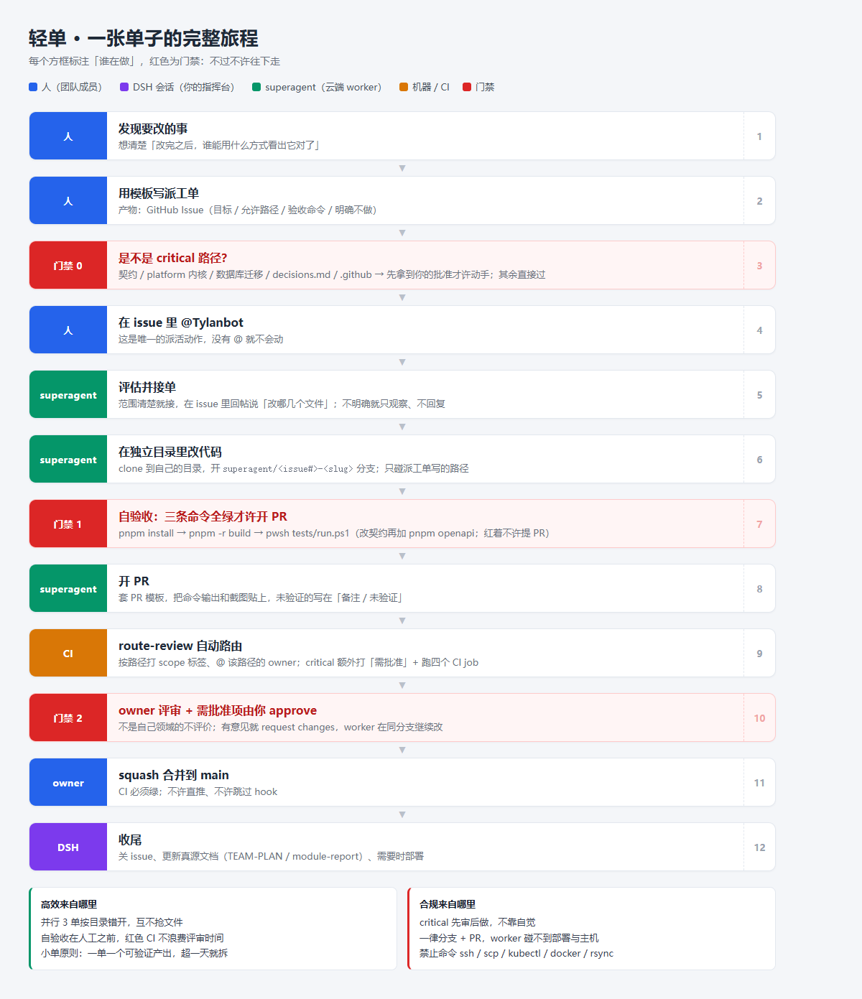
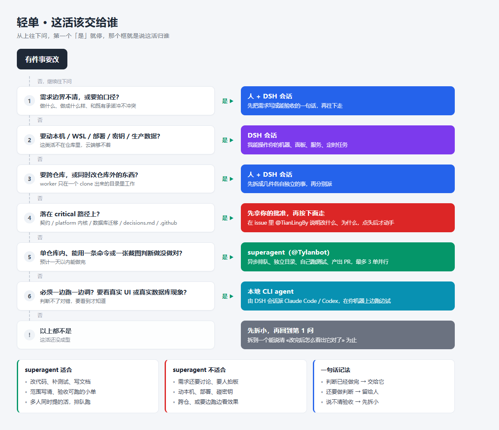

# AI 协作工作流

> 适用范围：本仓库（`TianLingBy/qingdan`）上所有代码 / 文档改动。
> 真源关系：人 → `docs/TEAM-PLAN.md`；路径 → `docs/OWNERSHIP.md`；任务与进度 → GitHub Issues / PR。
> 本文只规定**流程**，不重复上面两份的归属结论。最近更新：2026-11-15

## 两张图看完





（源文件：`docs/assets/workflow-flow.html`、`docs/assets/workflow-tree.html`，改图后重新截图覆盖同名 png。）

---

## 1. 四个角色，各干各的

| 角色 | 是什么 | 能做什么 | 不能做什么 |
|---|---|---|---|
| **人**（团队成员） | 6 位成员 | 定方向、拆需求、评审、拍口径 | —— |
| **DSH 会话**（本机） | 负责人的指挥台 | 澄清需求、裁定口径、拆任务、派活、跑验收、管本机环境、部署、写文档 | 不替队友写他们板块的业务代码 |
| **superagent**（云端） | GitHub 工单执行器，身份 `@Tylanbot` | 被点名后接单 → clone → 改代码 → 自验收 → 开 PR | 不主动找活、不澄清需求、不碰本机、不跨仓、不直推 main |
| **本地 CLI agent**（Claude Code / Codex） | 由 DSH 会话派发的编码代理 | 探索性改动、需要本地跑起来的调试、批量重构 | 不直接提交、不绕过验收 |

**一句话分工**：需要有人做判断的活 → 人 + DSH 会话；判断已经做完、只剩改代码的活 → superagent；要一边跑一边试的活 → 本地 CLI agent。

---

## 2. 分诊：这活交给谁

从第一个问题往下走，**命中即停**：

1. 需求边界不清、需要口径裁定、涉及产品承诺？ → **人 + DSH 会话**（先把需求写成明确的验收标准）
2. 要动本机 / WSL / 部署 / 面板 / 密钥 / 生产数据？ → **DSH 会话**
3. 跨仓库，或要同时改仓库外的东西？ → **DSH 会话 + 人**
4. 是 `critical` 路径（见 OWNERSHIP 第二节）？ → **先拿 TianLingBy 批准**，再按下面走
5. 一个仓库内、目标可验证、预计 ≤ 1 天？ → **superagent**（开派工单 + `@Tylanbot`）
6. 要边跑边调、要看真实 UI / 真实数据库现象？ → **本地 CLI agent**（由 DSH 会话派发）

判据只有一条：**能不能用一条命令或一张截图判断它做对了**。能 → superagent；不能 → 先由人或 DSH 会话把它变成「能」。

---

## 3. 任务生命周期

```
① 立项(人/DSH)  →  ② 接单(superagent)  →  ③ 执行  →  ④ 自验收
                                                    ↓
⑨ 收尾  ←  ⑧ 合并(owner)  ←  ⑦ 评审(owner)  ←  ⑥ 路由(CI)  ←  ⑤ 开 PR
```

| # | 谁 | 在哪 | 产物 | 硬要求 |
|---|---|---|---|---|
| ① 立项 | 提需求的人（可用 DSH 会话起草） | GitHub Issue，用 `.github/ISSUE_TEMPLATE/task.yml` | 一张带目标 / 允许路径 / 验收命令 / 明确不做的派工单 | 验收方式必须能跑出结果；范围必须写到目录级 |
| ② 接单 | superagent | Issue 评论 | 接单声明（改哪些文件、打算怎么做） | 只在被 `@Tylanbot` 且符合接单规则时接；不明确就保持观察、不回复 |
| ③ 执行 | superagent worker | 独立目录 `/root/.dsh/state/superagent/work/<工单>`，分支 `superagent/<issue#>-<slug>` | 代码改动 | 只改派工单写明的路径；超出范围就停下在 issue 里说明 |
| ④ 自验收 | superagent worker | 同一目录 | 命令输出贴在 PR 里 | 见第 6 节清单，**必须全跑**；跑不过不许开 PR |
| ⑤ 开 PR | superagent | GitHub PR，套 `pull_request_template.md` | PR + 分支 | 写清验证输出、跨模块影响；未验证的事写在「备注 / 未验证」 |
| ⑥ 路由 | CI `route-review` | PR | 标签 + @owner | 自动，人不干预 |
| ⑦ 评审 | OWNERSHIP 里的 owner | PR review | approve / request changes | 打 `需批准` 的必须 TianLingBy approve |
| ⑧ 合并 | owner | GitHub | squash merge 到 main | 合并前 CI 必须绿；不许 --no-verify、不许直推 |
| ⑨ 收尾 | 发起人 / DSH 会话 | Issue 评论 + 文档 | 关闭 issue、更新 `module-report` / TEAM-PLAN 动态 | 改动涉及口径或分工的，同时更新对应真源文档 |

---

## 4. 派工单怎么写

**合格的一单**：

```markdown
@Tylanbot

目标：apps/web 主数据-商品资料列表，分页默认 20 条，切页时把当前页码显示在标题右侧。

允许改动：
- apps/web/src/pages/masterdata/products/
- apps/web/src/pages/masterdata/products/__tests__/

验收：
- pnpm install --frozen-lockfile
- pnpm -r build
- pwsh -NoProfile -File ./tests/run.ps1
- 截图：第 1 页 20 行，页码显示「1 / N」

明确不做：不动后端接口、不动 packages/contracts、不重构表格组件。
```

**不合格的三种**（会被评估为不明确 → 不接单）：

- 「`apps/web` 有点乱，你整理一下」—— 无目标、无范围
- 「把系统做得更快」—— 无法验收
- 「改一下 `packages/contracts` 的字段」—— 红线路径且没写批准

---

## 5. 防撞车（效率的关键）

**唯一真源**：一个文件同一时间只有一个人改。

| 机制 | 做法 |
|---|---|
| 路径锁 | 开工前看有没有 open PR 碰同一目录；有就在 issue 里对齐，不并行 |
| 声明式占位 | 接单声明里写明「我改 A/B，不动 C」，别人据此避让 |
| 并行上限 | superagent 并行 3 单，**调度按路径不重叠**：一个走 `apps/web`，一个走 `apps/api/src/modules/inventory`，一个走 `docs/` |
| 分支前缀 | `superagent/<#>-<slug>`、`feat/`、`fix/`、`docs/`，一眼看出是谁在改 |
| 单点目录 | `apps/web/src/components/**` 只有 Meow-Yay 改；业务实现者提需求不提代码 |
| 小单原则 | 一单一个可验证产出；超过 1 天就拆 |

---

## 6. 自验收清单（superagent 开 PR 前必须全跑）

```bash
pnpm install --frozen-lockfile
pnpm -r build
pwsh -NoProfile -File ./tests/run.ps1      # 跑全部 tests/*.test.ps1
```

改动命中以下情况时追加：

| 情况 | 追加命令 |
|---|---|
| 动了 `packages/contracts/` | `pnpm openapi` 并提交 `docs/api/openapi.yaml`（CI 会校验未漂移） |
| 动了数据库语义 / 取号 / 锁 | 相关 `tests/db-concurrency.test.ps1`、`tests/e2e-business-flow.test.ps1`（worker 环境没有 PostgreSQL，这两项由 CI 的 `integration` job 兜底，PR 里写明「本地未跑，等 CI」） |
| 动了 `apps/web` | 截图或组件级断言，写在 PR 的「怎么验证」 |
| 动了文档 | 检查纯 LF、无 BOM、无 CRLF |

跑不过的处理顺序：**先在本地修，修不动就在 issue 里贴输出并说明卡在哪**，不许带着红测试开 PR。

### 执行环境基线（worker 必须一致，2026-11-15 实测）

| 组件 | 版本 | 为什么必须一致 |
|---|---|---|
| Node | 24.x（实测 24.22.3） | `tests/platform-spec.test.ps1`、`tests/workspace.test.ps1` 里有 `Assert-True ($nodeMajor -eq 24)`；Node 22 会直接 FAIL |
| pnpm | 11.x（实测 11.28.10） | 同上，断言 `^11\.`；pnpm 10 会与仓库 store 冲突 |
| PowerShell | pwsh 7.5.4 | `tests/run.ps1` 用 `& pwsh` 逐个子进程跑 |
| git / gh | git 2.x（实测 2.43+）、gh 2.104.0 | 分支、PR、凭证走 `gh-agent` |

worker 跑在 WSL2 Ubuntu 里，`node -v` → `v24.22.3`、`pwsh` → `7.5.4`、`pnpm -v` → `11.28.10` 是当前基线。

**已知坑（Node 24 特有）**：Node 24 把进程的 `comm` 改成了 `MainThread`，`scripts/dsh-superagent` 的进程探测只认 `node`/`dsh`，会让 `status` 永远返回 `pids: []`、`stop` 杀不掉进程。已在 WSL 内把两处判定补成 `('node', 'dsh', 'MainThread')`（备份 `scripts/dsh-superagent.bak-*`）。**升级/重装 dsh-superagent 后必须重打这个补丁**，否则定时巡检会重复起服务。

**已知坑（派单不生效）**：`src/sources/github.ts` 里 `issue.user.login` 与评论作者都过 `sameName(..., login)` 过滤 —— **agent 自己账号（@Tylanbot）建的 issue、发的评论一律丢弃**，防自激。所以派工单必须由人类账号（名单内六人之一）发出并 `@Tylanbot`；用 Tylanbot 自己 `gh-agent issue create` 建的单纯属空转。

**已知坑（换了研判模型却不生效）**：评估走的是「主 Session」，而 `src/app/role-models.ts:17` 一旦该 session 已有 `requestHeader` 或 `model/selection` 事件就直接 return，不再覆盖。结果是面板里把研判模型从 `deepseek-official` 改成 `deepseek-account` 只对**新**会话有效，老会话仍旧用老 provider，表现为「评估进行中」挂到超时（`decision.kind=unavailable`, `reason=[timeout]`），服务日志里没有任何报错。处理：停服务 → 备份并删除 `/root/.dsh/sessions/--root-.dsh-state-superagent--/<masterId>/` 与 `/root/.dsh/storages/session_projcache/sessions/orchestrator-*.json` → 清 `thread`/`disposition` 表 → 起服务 → 重新 `@Tylanbot`。脚本：`C:\Users\32800\wsl-setup\reset-session.sh`。

---

## 7. 红线与审批

1. `critical` 路径（OWNERSHIP 第二节）**先批准后动手**：在 issue 里 @TianLingBy 说明改什么、为什么，拿到明确同意再改。
2. PR 被打 `需批准` 时，合并按钮只对 TianLingBy 有效。
3. 任何执行器**不直推 main**，一律分支 + PR。
4. 不碰生产数据、不碰密钥、不在 CI 里存口令。
5. `docs/decisions.md` 只允许追加，不允许改写既有结论。

---

## 8. 失败与回滚

| 现象 | 处理 |
|---|---|
| 评估判定不明确 → 不接单 | 发起人补全派工单（范围 / 验收）后重新 `@Tylanbot` |
| worker 中途失败 | issue 里会附命令输出；缩小范围重开一单，或转本地 CLI agent |
| PR CI 红 | 在 PR 评论里 `@Tylanbot` 说明失败项，它会在同一分支续做 |
| 合并后发现回退 | `git revert` 走同一套 PR 流程；不允许热修直推 |
| 服务异常（不接单 / 不回帖） | 在 DSH 会话里跑 `C:\Users\32800\wsl-setup\sa.ps1 status` 看 health，`restart` 重启 |

---

## 9. 日常节奏

**每个人**

- 每天开工先看 <https://github.com/TianLingBy/qingdan/issues>，只看两件事：被 assign 的、被 @ 的
- 要派活：写派工单 → `@Tylanbot`
- 被请求评审：24 小时内给结论（approve / request changes + 具体理由）

**负责人 / DSH 会话**

- 上午：过一遍新 issue，做分诊（第 2 节），把不明确的打回、把可派的 `@Tylanbot`
- 下午：过一遍待评审 PR，处理 `需批准`，合并绿的
- 收尾：更新 TEAM-PLAN 动态、module-report、知识库沉淀

**每周**

- 看一次度量：首次 CI 通过率、平均合并时长、回退次数
- 三个指标里任一恶化，就改规则或改派工单模板，而不是骂执行器

---

## 10. 配置在哪

| 项 | 位置 |
|---|---|
| 接收范围 / 监听仓库 / 智能体 GitHub CLI | 面板 设置 › 来源 |
| 接单规则、能发起工作的账号、准入表、接单模式 | 面板 设置 › 评估（当前：自动接单） |
| 执行目录、准备命令、并行数、执行器模型、禁止命令 | 面板 设置 › 执行 |
| 团队约定（执行器读到的提示词） | 面板 设置 › 提示词 |
| 服务控制 | `C:\Users\32800\wsl-setup\sa.ps1 status\|start\|restart\|stop\|log` |
| 面板地址 | `http://127.0.0.1:3082/?token=<见 sa.ps1 open>` |
| 路径归属真源 | `docs/OWNERSHIP.md` + `.github/workflows/route-review.yml`（必须同步） |
